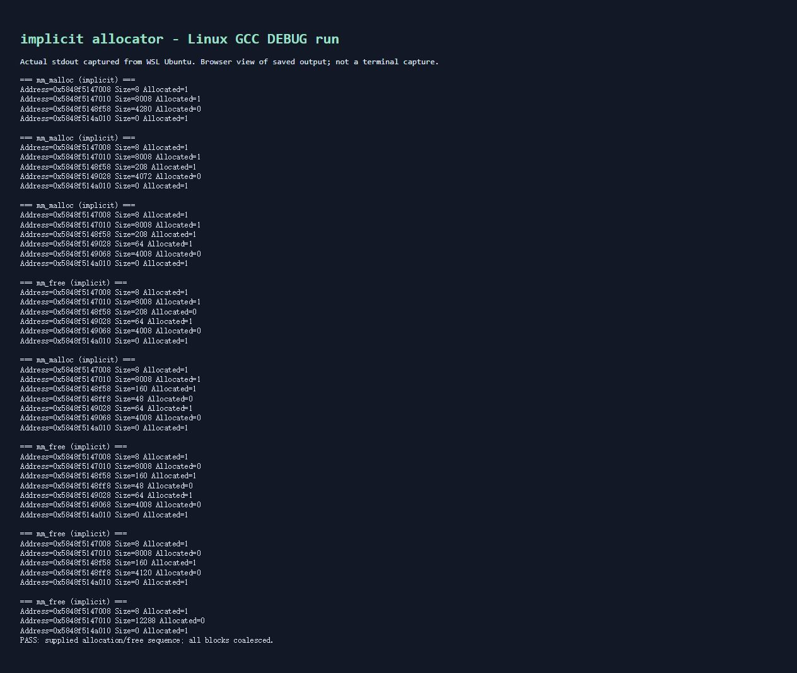
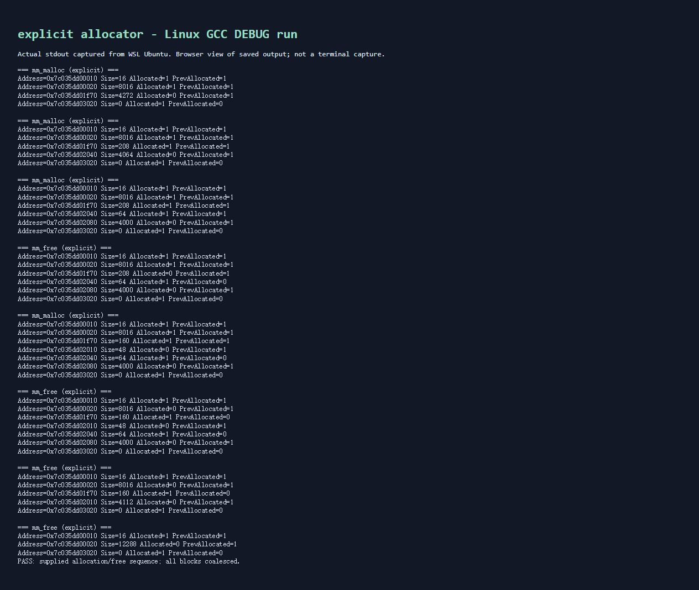

# 动态内存分配
## 前置知识
1. 堆是用于动态存储的一类内存区域；对象生命周期由程序的分配/释放操作决定，不随函数返回自动结束。Linux分配器可用brk/sbrk或mmap取得区域，并不是所有malloc都一定扩大brk。
2. 分配器在管理区域中寻找、分割、回收块；**空闲块**是仍由分配器管理、可再次利用的块。free通常归还给分配器，不等于立即归还操作系统。
3. 对齐使负载起点满足规定倍数，便于正确和高效访问数据；块大小也按倍数取整，因此最低若干位恒零，可以存放alloc等标志。例如8字节对齐时低3位可用，取size需屏蔽这些位。
4. 内部碎片是已分配块中用户没用到的填充和舍不得分割的小尾部；外部碎片是散落的空闲块总量够但没有单个连续块够。分割降低浪费、立即合并减少相邻空闲碎片，但都不能保证消除所有碎片。
5. 吞吐量是单位时间处理的申请/释放次数；空间利用率常用有效负载峰值与分配器取得的堆大小衡量，具体指标应依实验驱动定义。扫描更仔细可能找到更紧凑的块，但降低吞吐量。
## 实验0：最简单的malloc

### 思考：为什么不能随意free新增长的空间？

brk只有一个边界。回退边界只能退去连续空闲的堆顶；不能释放中间一个块而保留其上方仍在使用的对象。实验0没有保存块大小、状态等元信息，甚至不能一般性识别释放范围。所以需要记账和复用，不直接在free中倒退brk。

## 实验1：隐式空闲链表

### 为什么用链表，不用数组？

物理内存本来就是连续字节区，完全可以用数组模拟。隐式链表不是另建节点保存地址，而是用当前块size算下一块，支持不同大小块；等步长数组索引不适合这种布局，另建索引表则需要额外空间和维护。显式链表只把空闲块用pred/succ连接，顺序不必等于物理地址顺序。

### 宏定义、size与alloc打包、ftr的作用

footer使下一块能O(1)找到前一块起点，形成边界标记，用于双向合并。宏或短辅助函数把偏移与位规则集中，避免每处手写出错；本代码用短函数替代部分宏，含义一致且参数只求值一次。PACK利用对齐留下的低位保存标志，不需额外单独字段。

### 分割和合并是否产生多余header/footer？

分割会建立两个块各自需要的边界标签，只有剩余达到最小块大小才分割。隐式最小16字节；显式最小32字节，要容纳8字节header、两个8字节指针和8字节footer。合并时更新新块外边界，原中间标签仅成为可覆盖的内部字节，不再作为块遍历，不造成永久额外元信息泄漏。

### 时间复杂度与性能改进

隐式首次适应最坏O(B)，B为所有块数；无法跳过已分配块，因为没有单独索引空闲块。显式首次适应最坏O(F)，F为空闲块数；最佳适应也需扫描F个块。带双向指针的摘链、头插、已知邻居的合并均O(1)。realloc搬迁还需O(复制字节数)。可进一步用分离适配链表、大小类或树索引，但本实验不扩展到这些实现。

### 为什么找不到块时不再全堆合并？

本实现free和extend_heap都立即合并，保持“无相邻空闲块”，搜索失败后再扫描不会创造新机会，只增加时间。若使用延迟合并，才可在搜索失败或达到阈值时统一合并。题目说“只有free才合并”不是本实现采用的不变量；扩堆也合并堆尾空闲块。


### C代码及输出结果

[隐式空闲链表完整代码](../../Code/mm_implicit.c)



## 实验2：显式空闲链表

显式place先摘除原空闲节点，再写已分配头；若分割，给剩余部分写header/footer并头插。free先标记本块空闲，coalesce先摘除相邻空闲节点，再写合并边界并插入一次。每次都同步物理后继的prev_alloc，包括结尾块，避免把用户数据误当成footer。

realloc扩大采用申请新块→复制原负载→释放旧块；失败不释放旧块。缩小时能分割就分割并合并尾部；否则保留原块。没有实现邻接空闲块原地扩大优化，不影响正确性。

### C代码及输出结果

[显式空闲链表完整代码](../../Code/mm_explicit.c)



## 实现中的问题与处理

1. 实验1初始化的最后一次PUT应写base+3*WSIZE，不能覆盖最前面的对齐填充；否则结尾块未初始化。
2. 实验1每块的header/footer都记录**本块**大小和分配位。通过bp-DSIZE读到的是**前块footer**，因此能得知前块状态。不是把本块footer解释为前块的状态。
3. 实验2已分配块没有footer，使用header中的prev_alloc阻止读取前一个已分配块的负载；仅当前块header表明前块空闲时，才能经前块footer反向定位。
4. malloc/realloc的size统一指用户需要的负载字节数，与标准接口及实验1一致；分配器内部补header/footer和对齐。模板实验2关于size“包括头尾”的注释与常见接口不一致，故在此明确约定。
5. 实验1真实调用sbrk，并向4096倍数扩堆；实验2通过mmap预留5MB，mm_sbrk仅在该区间推进模拟堆顶。题文提到“堆1堆2”但未给出相应详细图示，本实现明确采用预留区+逻辑堆顶模型。
6. 两版均为教学用、单线程、非libc替代品。隐式版不能与其他sbrk用户并发共享堆；关闭stdout缓冲并检查真实brk是否符合预期。两版额外设5MB测试上限；free仅接受本分配器返回且尚未释放的块或NULL。
7. 使用uint32_t/uint64_t保存元信息，memcpy读写避免类型别名问题；指针字段按真实指针宽度保存，实验2要求64位环境。8/16字节对齐分别遵照实验，并不声称隐式8字节版满足所有平台的max_align_t要求。

## 编译与测试

- [实验1完整独立C文件](../../Code/mm_implicit.c)
- [实验2完整独立C文件](../../Code/mm_explicit.c)
- [实验1原始输出](../../results/implicit-demo.txt)
- [实验2原始输出](../../results/explicit-demo.txt)
- [实验1结果截图](../../results/implicit.jpg)
- [实验2结果截图](../../results/explicit.jpg)

在仓库根目录的 Linux 终端执行：

```sh
gcc -std=c11 -Wall -Wextra -Werror -g -DDEBUG C/Code/mm_implicit.c -o /tmp/implicit
gcc -std=c11 -Wall -Wextra -Werror -g -DDEBUG C/Code/mm_explicit.c -o /tmp/explicit
/tmp/implicit
/tmp/explicit
/tmp/implicit --test
/tmp/explicit --test
# 显式版本也支持最佳适应：
gcc -std=c11 -Wall -Wextra -Werror -g -DDEBUG -DBEST_FIT C/Code/mm_explicit.c -o /tmp/explicit_best
/tmp/explicit_best --test
```


