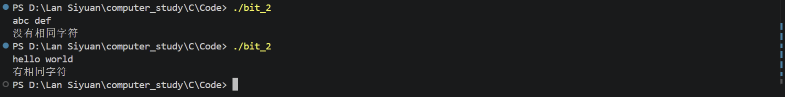

# 位级操作
## 任务一
1. 211 = 128 + 64 + 16 + 2+ 1
   所以其对应二进制数为11010011
2. 10110110对应十进制数为$2^7+2^5+2^4+2^2+2^1=182$
3. 通过判断对2取模是否为1，如果是1就是奇数，如果不是1就是偶数
## 任务二
### 代码及输出结果
1. 输出结果是8，29，21，60因为                    `00001100 & 00011001 == 00001000` `00001100 | 00011001 == 00011101` `00001100 ^ 00011001 == 00010101` `00110000 | 00001100 == 00111100`

2. 1. C代码
 ```c
#include <stdio.h>
#include <string.h>
#include "console_utf8.h"

int bit_1(void)
{
    int n, x;

    printf("请输入一个整数x和一个位数n：");
    scanf("%d %d", &x, &n);

    return (x >> (n-1)) & 1;
}
int bit_2(void){
    int x,n,t;
       printf("请再次输入一个整数x和一个位数n以及一个修订值（0或1）：");
       scanf("%d %d %d",&x,&n,&t);
       return (x & ~(1u << (n - 1))) | (t << (n-1));
}
int bit_3(void){
    int x;int i = 0;
     printf("请输入一个整数x：");
     scanf("%d",&x);
     if (x == 0)
     return 0;
     else{
     while(i < 32)
     {if(x & 1<<i)
     break;
     else
     i++;}
     return 2^(i+1);}
}
void bit_4(const char *a, const char *b, char c[]){
    int lena = strlen(a);
    int lenb = strlen(b);
    int j  = 0;
    if(lena == lenb){
        for(int i=0;i<lenb;i++){
            if(j == 0&&a[i]==b[i]){
            c[i]=a[i];
            }
        else {
        j = 1;
        c[i] = '0';
        }
    }
    c［lenb］ ='＼0'
    }
    else{
    c[0] = '0';
    c［1］ ='＼0';
    }
}
int main(void)
{
    init_console_utf8();   // 防止输出乱码
 
    printf("%d\n", bit_1());
    printf("%d\n", bit_2());
    printf("%d\n", bit_3());
    char a[101],b[101],c[101];
    scanf("%100s %100s",a,b);
    bit_4(a,b,c);
    printf("%s\n",c);
    return 0;
}
```

   2. 输出截图

### 思考题
1. 逻辑运算与位运算
区别：逻辑运算把整个数看成真和假零（假）非零（真），输出结果结果只有0（为假）和1（为真）而位运算关注的是一个二进制数每一位怎么变化
联系：都是与，或，非这类逻辑规则对数值进行运算，都涉及0和1的逻辑关系，只是作用对象不同
1. 运算律
   1. **交换律**
   `a & b = b & a`  
   `a | b = b | a`  
   `a ^ b = b ^ a`
   2. **结合律**
   `(a & b) & c = a & (b & c)`  
   `(a | b) | c = a | (b | c)`  
   `(a ^ b) ^ c = a ^ (b ^ c)`
   3. **幂等律**
   `a & a = a`  
   `a | a = a`
   4. **与 0、全 1 的运算**
   `a & 0 = 0`  
   `a | 0 = a`  
   `a ^ 0 = a`  
   `a & ~0 = a`
   5. **异或的特殊性质**
   `a ^ a = 0`  
   `a ^ 0 = a`
   因此同一个数连续异或两次可以恢复原值：
   `a ^ b ^ b = a`
   6. **取反性质**
   `~~a = a`
   `a & ~a = 0`  
   `a | ~a = ~0`
   7. **德摩根律**
   `~(a & b) = (~a) | (~b)`  
   `~(a | b) = (~a) & (~b)`
   8. **分配律**
   `a & (b | c) = (a & b) | (a & c)`  
   `a | (b & c) = (a | b) & (a | c)`
2. 算数右移对应有符号数，逻辑右移对应无符号数的原因
   无符号整数对应编码表示规则中所有位权重都是正的，所有二进制位都用于表示数值，因此逻辑右移时高位直接补 `0`。
   有符号整数对应的补码规则中，最高位权值是负的，算术右移需要保持原数的符号，因此高位补原来的符号位：原符号位为 `0` 时补 `0`，原符号位为 `1` 时补 `1`。
   
   ## 任务三
   [代码](../../Code/bit_2.c)
   

   ## 任务4
   

