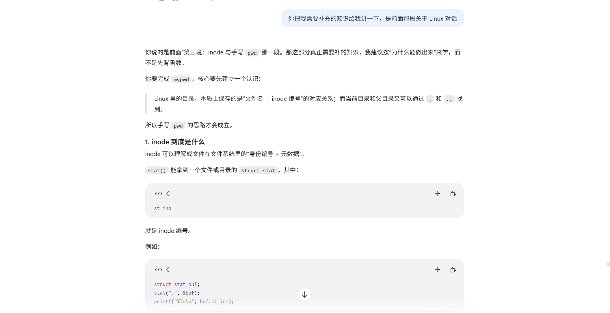
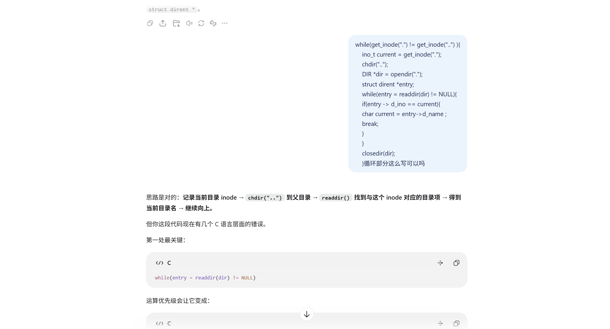

# 初识Linux系统
## 第一境：算者—— 命令行参数与路径
### 任务 1.1：不同的路
1. 绝对路径是从根目录 / 开始描述文件或目录位置的完整路径，与当前工作目录无关，可以唯一确定一个文件或目录的位置。  
2. 相对路径：相对当前目录开始描述文件的路径，通过 `.` 表示当前目录，而 `..` 表示上一级目录,相对路径依赖当前工作目录，不同的当前目录下，同一个相对路径可能表示不同的位置。  
3. 前往/var/backups/turing/的绝对路径 `cd /var/backups/turing/` 相对路径`cd ../../../var/backups/turing/`  
### 任务 1.2：何处启程
1. argc 即argument count,表示命令行参数的数量，包括程序名本身。,而argv 即argument vector即参数向量，本质上是`char *argv[]`,即字符串数组，保存命令行参数字符串的地址，且`argv[0]`一般指向程序名。  
2.  `cd /var/backups/turing/` 操作中argc = 2，`argv[0] = cd` , 而 `argv[1] = /var/backups/turing/` 而在 `cd ../../../var/backups/turing/` 中argc = 2,`argv[0] = cd` , 而 `argv[1] = ../../../var/  backups/turing/` 且对于上述两个指令argv[2]应该指向空指针。  
## 第二境：算王—— 重建 ls 命令与位运算
### 任务 2.1：非同寻常之物
1. `<stdio.h> <string.h> <stdlib.h>` 是我见过的，分别是标准输入输出头文件，字符串头文件和标准库头文件，而`<dirent.h> <sys/stat.h> <sys/types.h> <time.h>`是我比较少见或几乎没见过的
2. `<dirent.h>` 提供了 `DIR` 和 `struct dirent` 等结构体，以及 `opendir()`、`readdir()`、`closedir()` 等函数。其中 `DIR` 用于表示打开的目录，`struct dirent` 用于保存目录中的文件信息，这些函数主要用于打开目录、读取目录内容和关闭目录。  
`<sys/stat.h>` 提供了 `struct stat` 结构体以及 `stat()` 等函数。其中 `struct stat` 用于保存文件的属性信息，例如文件大小、权限、修改时间等，`stat()` 函数用于获取指定文件的状态信息。
### 任务 2.2：看看权限
```c
// mode即传入的存储权限信息的整数， 如0754（八进制表示）
// 提示：传入的 mode 变量不仅包含权限信息，高位可能还包含文件类型。在进行位运算时，请注意屏蔽（Mask）掉不需要的高位数据。
void parse_permissions(mode_t mode, char *perms) {

    // 权限字符对照表
    char rwx[] = {'r', 'w', 'x'};
    mode &= 0777;
    for(int i = 0; i < 9; i++)
    {
        if(mode & (1 << (8-i)))
            perms[i] = rwx[i % 3];
        else
            perms[i] = '-';
    }

    perms[9] = '\0'; // 字符串结尾
}
```
思考：通过编写 myls，我对 Linux 中文件与目录的管理方式有了更深入的理解。我开始只知道 ls 可以查看文件，却不了解它是如何获取文件信息的。，通过对学长给出的myls代码的研究，我逐渐认识了 opendir()、readdir() 和 stat() 等函数的作用，理解了如何通过目录项获取文件名，再查询文件的类型、权限、大小等属性。以及将 st_mode 中的权限信息通过位运算转换为 rwx 字符串，也让我进一步体会到位运算在实际编程中的应用。
写代码过程中的问题：最开始我if条件里面写的是if(mode & (1 << i))，没有考录到i从零开始增长，从最低位开始检查，改成 if(mode & (1 << (8-i)))后当i等于0是检查的才是从第八位开始检查
## 第三境：算尊—— 深入理解 Inode 与文件树
### 任务 3.1：万物皆 Inode
1. inode保存文件的类型，权限，拥有者，大小，时间信息，数据块位置
2. inode不含文件名
3. "."指当前目录".."指父目录，因为根目录是没有父目录所以"/"的"."的inode编号和".."inode编号相同
### 任务 3.2：寻我来时路
[mypwd代码](../../Code/mypwd.c)
AI辅助我对对inode有关知识梳理和代码错误的检查


## 最终境：算帝—— 递归与文件筛选
### 任务 4.1：敢问，路在何方？
```c
#include <stdio.h>
#include <string.h>
#include <dirent.h>
#include <sys/stat.h>
#include <unistd.h>

// 递归查找指定文件，若找到则打印其相对路径
void find_file(const char *current_path, const char *target_name) {
    DIR *dir;
    struct dirent *entry;
    struct stat statbuf;

    if (!(dir = opendir(current_path))) {
        return; // 无法打开目录则跳过
    }

    while ((entry = readdir(dir)) != NULL) {
        // 忽略当前目录 . 和父目录 .. 防止无限死循环
        if (strcmp(entry->d_name, ".") == 0 || strcmp(entry->d_name, "..") == 0) {
            continue;
        }

        char full_path[1024];
        snprintf(full_path, sizeof(full_path), "%s/%s", current_path, entry->d_name);//将current_path/entry->d_name写入full_path

        if (stat(full_path, &statbuf) == -1) continue;

        // 请补全代码写在 TO DO 与 END OF TO DO 之间：
        // 要求：
        // 1. 检查当前 entry 的文件名是否与 target_name 匹配，若匹配则打印 full_path。
        // 2. 如果当前 entry 是一个目录，则需要对其进行深度优先的递归查找。
        // （提示：若(statbuf.st_mode & S_IFMT) == S_IFDIR则statbuf为目录文件）
        if (strcmp(entry->d_name,target_name) == 0)
        printf("%s",full_path);
        if((statbuf.st_mode & S_IFMT) == S_IFDIR)
        find_file(full_path,target_name);
    }
    closedir(dir);
}
```
代码书写中的问题：在if条件中直接if (entry->d_name == target_name)，忽略了他们是字符串，可以用string.h中的strcmp函数来比较两个字符串是否相同