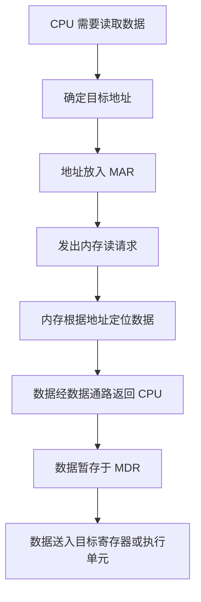
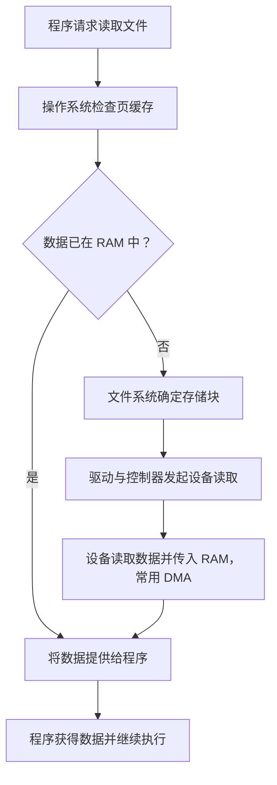

# 计算机系统内存与执行机制
## 阶段一：硬件拾荒者 —— 存储的物理层级
### 任务 1.1：识破奸商
1. 1. CPU(Central Processing Unit)即中央处理器，擅长进行复杂，多分支的任务是执行程序指令的核心，包含运算器，控制器，寄存器
运算器进行的是位运算，且运算的数据与结果储存在寄存器里面
   1. GPU(Graphics Processing Unit )即图像处理器，内涵大量并行单元，擅长进行大量重复运算，与各种游戏的图像，光线处理，画面生成密不可分，同时也可用于AI科学技术等任务。
   1. 主板，是吧计算机的CPU,GPU,内存，显卡，硬盘等各种部件通过总线等连接起来，含有供电电路负责各部件的供电，而且含有各种接口，以便连接外设，决定硬件的兼容性和部分扩展能力
2. 1. 不是一样的，电脑内存通常指向随机存取存储器，pc一般内存是由DRAM（动态随机存取存储器）实现，而手机内存一般相当于电脑硬盘容量，二者均是通过闪存实现的而且手机也有独立运行内存
   1. 主存：存放运行中程序的指令和数据，一般由DRAM实现，需要持续供电支持动态刷新，所以主存中的数据会在断电后消失 。内存：我们一般购买电脑时说的内存一般就是指电脑主存大小，其他时候需要根据上下文理解。储存：一般指存放数据的方式或设备，日常生活中一般指一台设备的保存文件的存储空间。
3. 电源选择的注意事项：
   - 一般选择电源额定输出功率是大于电脑各硬件额定功率，因为要考虑可能出现的瞬时峰值留有余量，所以要选择功率合适且留有余量的电源
   - 选择供电稳定，安全的电源，关注其对过压过流，短路，过温的保护功能
   - 选择转换效率高的电源，如80 PLUS等能效认证可反映塔顶条件下的转换效率
   - 选着与电脑硬件接口相兼容的电源
4. 都不一定，CPU和显卡的性能不能只看名称里面数字大小，CPU性能具体性能受产品代数，架构，核心数，频率，功耗，散热条件等的影响最新一代的i5可能比较老一代的i7性能高，而显卡性能 应该看具体型号，实际应用测试，显存容量显存带宽，功耗的的差异
5.  - 有毛病的地方不都用加粗字体写出来了吗。。。
    - 只说大牌主板，却不说具体是什么牌子，什么型号，以及具体的接口，供电规格和兼容性，无法判断是否适合该机型。
    - 比i5主板多i2的i7主板，主板型号不是能直接加减的数量，应该提供CPU的具体信息
    - 16G高端内存，16G只能说明他的容量，而不能说明是否高端，应看具体配置比如DDR代数，传输速率，时序，通道配置等
    - 比上一代性能高一半的豪华GPU，依旧前面带的是一个形容词豪华且不说具体型号与配置，无从知晓他的上一代又是什么
    - 512G 内存，将手机闪存储存空间与运行内存混淆，混淆随机存取存储器与闪存存储（虽然一般日常生活购买手机就是这么说的）
    - 1.25T超大内存，不说是HDD还是SSD，也不说具体结果，速度与质量，仅凭容量无法断定性能高低
### 任务 1.2：你问我答
1. |存储介质|	典型应用|	主要特点|	对计算机的作用|
   |-------|----------|----------|----------------|
   |SRAM   | CPU 的 L1/L2/L3 Cache 等|	速度快、无需周期性刷新，但单元面积较大、成本较高，断电丢失数据|	以较低访问延迟保存常用数据，减少 CPU 等待时间|
   |DRAM	  | 电脑主存（内存条）等|密度高、单位容量成本较低；需要定期刷新，断电丢失数据	|以相对可接受的成本提供 GB 级运行内存|
   |NAND Flash	|SSD、U 盘、手机内部存储	|非易失性、密度高；擦写寿命有限，写入/擦除通常比 DRAM 慢|长期保存系统、软件、文件等数据|
   |HDD	|机械硬盘、大容量数据存储设备|	磁性记录、断电不丢失；有机械寻道和旋转延迟，随机访问通常比 SSD 慢	 |以相对较低的单位容量成本提供大容量持久存储|
2.  - 寄存器(Register)：位于CPU内部的高速存取单元，保存当前执行指令的数据，地址或控制信息
    - 高速缓存(Cache)：位于CPU与主存中间的高速储存层次，现代CPU的 L1/L2/L3 Cache缓存一般集成在处理器芯片内，有SRAM组成
    - 只读存储器(ROM): 一般指内容固定或不便修改的非易失性存储器，适合保存固件等内容。
3. DRAM的是有一个晶体管和一个电容组成，晶体管充当访问开关，电容通过不同的电荷状态表示二进制数据。字线控制晶体管的导通，位线用于读写数据。写入时，存储电路通过位线为电容设置相应的电荷状态。读取时，电容与位线发生电荷共享，感应放大器识别微弱的电压变化。典型 DRAM 读取过程会扰动原有电荷，因此需要恢复数据。由于电容会漏电，即使数据不被访问，电荷也会流失，所以需要在供电状态下周期性刷新才能保证数据不丢失，因此断电后主存中的数据全部丢失
4. Cache的根本原理是局部性原理，具体又分为时间局部性原理和空间局部性原理，时间局部性原理指的是之前访问过的数据在一段时间后很可能再次访问，而空间局部性原理指的是之前访问过的数据的相领空间上的数据很可能在之后被访问。Cache通常是通过缓存行加载和管理数据，当所需数据在Cache中时被称为命中，可以快速调用数据，而所需数据不在Cache中是被称为未命中，需要从下一级储存空间中获取数据，同时内存不足是Cache中数据的替换遵循某一特殊策略进行替换选择替换行
5. 比起下面这段矩阵运算的代码A,代码A以i-j-k的顺序进行虽然a[i][k]遵循空间局部性原则，但是b[k][j]是跨行进行不利于空间局部性，而代码B以i-k-j的顺序进行a[i][k]遵循时间局部性的同时b[k][j]也遵循了空间局部性
 ```c
for(int i = 0;i < n;i++){
   for(int j = 0;j < n;j++){
      for(int k = 0;k < n;k++){
         c[i][j] = a[i][k] * b[k][j]
      }
   }
}
```
这段代码B更优
```c
for(int i = 0;i < n;i++){
   for(int k = 0;k < n;k++){
      for(int j = 0;j < n;j++){
         c[i][j] = a[i][k] * b[k][j]
      }
   }
}
```
## 阶段二：虚拟空间潜行 —— MMU 与页表机制
### 任务 2.1：揭开虚拟的面纱
1. 虚拟地址是程序运行中使用的地址，物理地址是虚拟地址经过翻译后得到的用于在真实物理内存中定位的地址，所以即使相同的虚拟地址对应的物理地址也并不相同，而虚拟内存是一套内存管理机制，它让程序通过虚拟地址空间访问内存，由操作系统和硬件负责管理地址映射、访问权限，以及内存的分配与回收。虚拟内存的好处：1.隔离和保护进程：避免普通程序随意访问其他进程的内存。2.简化程序开发：程序可以在自己的虚拟地址空间中工作，不必直接管理所有物理地址。3.灵活管理内存：系统可以按需分配和映射内存，也可以让部分虚拟内存内容暂时存放在文件或交换空间中。
2. - 32 位系统虚拟地址空间的特性是每个进程通常拥有独立的虚拟地址空间。不同进程可以使用相同的虚拟地址，但这些地址可以映射到不同的物理内存位置，而大小是32 位虚拟地址由 32 个二进制位组成，因此理论上的虚拟地址空间大小为： $2^{32}\text{ Bytes}=4\text{ GiB} $ 但是4 GiB 是理论地址空间大小，并不代表进程能够自由使用全部空间，也不代表计算机必须拥有 4 GiB 物理内存。
   - 虚拟地址空间通常以**页（Page）**为基本管理单位，在本题中采用 4 KiB 的页面大小： $4\text{ KiB}=2^{12}\text{ Bytes}$因此，一个页面的页内偏移需要 12 位表示。
   - 常见的进程虚拟地址空间可以划分为以下区域：代码段（Text Segment）： 存放程序的机器指令，通常具有可读、可执行等权限。数据段（Data Segment）： 存放已经初始化的全局变量和静态变量。BSS 段： 存放未显式初始化或初始化为零的全局变量和静态变量。堆（Heap）： 用于动态内存分配，例如 C 语言中的 malloc()。栈（Stack）： 用于函数调用、局部变量及返回地址等信息的存储。内核空间（Kernel Space）： 用于操作系统内核及相关内核数据的地址映射。在常见的操作系统布局中，该区域受到特殊的访问权限保护。
   - **页（Page）**是虚拟内存中的固定大小的数据块，是操作系统管理虚拟地址空间的基本单位.**页框（Page Frame）**又称物理页框，是物理内存中与页面大小相同的存储区域，是页面映射到物理内存时所使用的基本单位。页表记录虚拟页与物理页框之间的映射关系。在本题中，页面大小为 4 KiB，因此物理页框大小也为 4 KiB。页和页框具有相同的大小，但它们属于不同的地址空间。
### 任务 2.2：认识页表管理
1. **页表（Page Table）**是操作系统用于管理虚拟地址到物理地址映射的数据结构。它记录虚拟页对应的物理页框以及相关的状态和访问权限等信息。页和页表不是同一个概念,页是 虚拟地址空间中的一块固定大小的区域，而页表是用于记录虚拟页与物理页框映射关系的数据结构，其包含页表项和页目录项。
2. **MMU（Memory Management Unit，内存管理单元）**是负责内存地址转换和相关访问权限检查的硬件单元。它根据虚拟地址和页表映射关系，确定对应的物理地址，并检查访问是否符合权限要求。  
**TLB（Translation Lookaside Buffer，转译后备缓冲区）**是一种用于缓存近期地址转换结果的高速硬件结构。  
MMU 负责地址翻译和相关检查，TLB 则通过缓存地址映射来加速这一过程。
3. 页表存储在主存（物理内存）中，CR3 寄存器保存当前页目录的物理基地址相关信息。MMU 可以利用该信息开始页表查询。
4. 二级页表将页表结构划分为页目录和多个二级页表：一级结构为页目录，页目录项指向相应的二级页表。二级页表的主要优势是节省页表占用的内存，在单级页表中，通常需要为整个虚拟地址空间的页面准备相应的页表项，然而在二级页表中，可以根据实际使用的虚拟地址区域分配相应的二级页表，而不必为所有可能的虚拟地址区域都分配二级页表。因此，对于地址空间稀疏的进程，二级页表通常可以减少页表的内存开销。
5. |字段|位数|含义|
   |----|----|---------|
   |页目录索引|10 位|用于查找页目录项|
   |页表索引|10位|用于查找二级页表项|
   |页内偏移|12位|表示目标数据在页面内的位置|
[代码](../../Code/mmu_simulator.c)及输出结果

| 虚拟地址 | 操作 | 预期结果 |
| ---- | ---- | ---- |
| `0x00001A2B` | 读取 | 成功，物理地址为 `0x0001AA2B` |
| `0x00001A2B` | 写入 | 成功，物理地址为 `0x0001AA2B` |
| `0x00002048` | 写入 | 触发保护错误（Protection Fault），因为目标页面为只读页面 |
| `0x00003555` | 读取 | 触发缺页错误（Page Fault），因为对应页表项无效 |
| `0x00804000` | 读取 | 触发段错误（Segmentation Fault），因为对应页目录项无效 |

### 深入理解内存与页表管理
1. | 寄存器              |      作用 |
   |--------------------|--------------------------------|
   |MAR（存储器地址寄存器）    |       保存要访问的内存地址 |
   |IR（指令寄存器）        |             保存当前取出的指令|
   |基址/索引寄存器       |               参与计算有效内存地址|
2. - 从 RAM 读取数据

  - 从 SSD / HDD 读取文件

3. 页面未驻留、按需分配或访问权限冲突等情况都可能触发异常；操作系统判断原因后处理，非法访问则可能终止进程。
      |    情况    |   操作   |
      |---------- | ---------------------|
      | 页面被换出	| 将页面重新调入 RAM |
      | 合法页面首次访问 |	分配并初始化物理页 |
      | 写时复制	| 分配新页、复制内容并更新映射 |
      | 地址非法或权限不允许 |	拒绝访问，通常报告错误 |
4. 页面替换
当需要调入新页面但没有空闲物理页框时，操作系统选择一个驻留页面进行替换。若被替换页面已修改且需要保留，可能要先写回存储。有以下几种替换算法
  算法    替换规则
  FIFO    替换最早进入内存的页面
  LRU     替换最长时间没有被访问的页面
  OPT     替换未来最晚才会再次访问的页面
  Clock   利用访问位给页面第二次机会
  ## 阶段三：致命一击 —— 深入调用栈与控制流挟持
  ### 任务 3.1：解剖函数调用栈
  1. 内存地址是由高位向低位增长
  2. 栈帧是函数调用使用的栈空间及相关数据。函数调用通常在同一线程的栈上建立新栈帧，而不是新开一个栈。
  3. EBP/RBP(基准指针)负责保存当前执行函数的栈的基准地址，以作参照标准方便定位，ESP/RSP(栈顶指针)负责指示当前栈顶位置
  4. 由基准指针和返回地址二者共同决定，返回地址在函数执行完后应继续执行的位置，基准指针指示栈帧从哪里开始
### 任务 3.2：赛博越权
1. password是一个只有16字节的字符串数组，但是gets函数不限制我的输入长度，我可以输入一串很长的字符串，使缓冲区溢出，溢出的部分就可能把低位内存地址中的 RBP 和 return adress 给覆盖住，被称为栈缓冲区溢出
2. 可以输入随便48个数字加00000000401156
### 任务 3.3：最后防线 —— 现代内存保护机制
Stack Canary 是一种用于防御栈缓冲区溢出的安全机制。它会在栈帧中的局部变量与关键数据之间设置一个特殊的检查值。函数返回前，程序会检查该值是否被改变。如果检查失败，说明栈上的数据可能遭到了破坏，程序通常会终止运行，从而降低返回地址被恶意篡改后造成的风险。
不过，Stack Canary 不能阻止所有缓冲区溢出，也不能修复已经被破坏的数据，需要与其他内存保护机制配合使用。

感觉这一节新概念比较多，很多概念我是在网上查询了一些资料来辅助我理解的，但同时由于马上要ddl了，可能完成的比较匆忙，学长不要在面试的时候盯着我这章的知识拷打了。